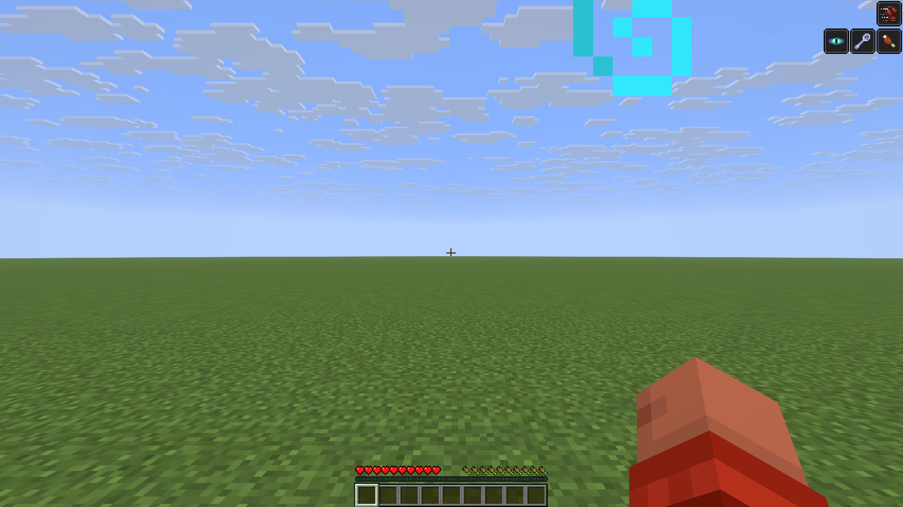

# Phantom Warning

      

**A tiny vanilla-style status icon that warns when insomnia makes phantom spawns possible.**
Client-side only · Minecraft 26.3 · Fabric and NeoForge

> **Based on the concept of [Insomnia Notifier](https://modrinth.com/mod/insomnia-notifier) by Arthur Ginzburg.
> Independently reimplemented for Minecraft 26.3 Fabric and NeoForge.**
> Phantom Warning is not affiliated with the original author. See [CREDITS.md](CREDITS.md).

## What it does

After more than three in-game days without resting, Minecraft starts rolling phantom spawns for you at night.
Phantom Warning shows a small icon exactly where vanilla shows harmful status effects, so you notice before the
phantoms do. No chat messages, no sounds, no banner in the middle of the screen.

- **Appears** when your time since the last rest is above 72,000 ticks (3 in-game days, the vanilla limit).
- **Disappears at once** when you lie down in a bed (a moment is enough) or die.
- **Overworld only** by default – vanilla spawns phantoms nowhere else.
- **Inventory:** while the inventory hides the HUD effect icons, the warning is listed in the effect list,
  with the days you have been awake and a short tooltip.
- **Game rule aware:** hidden when `spawn_phantoms` is known to be off (singleplayer / LAN host, or on servers
  where you are an operator). Where the rule cannot be known, it never hides the warning.

It is a warning, not a prediction: even with the icon, the server still rolls the regional difficulty, the
insomnia chance and a free spawn spot.

## Icons

| Insomnia (default) | Alert (optional) | Phantom style | Phantom style, alert |
|:---:|:---:|:---:|:---:|
|  |  |  |  |

The alert variant is only used with `advancedChecks=true`, when every condition the client can see is met:
night or thunder, open sky above you, at or above sea level, not in spectator mode, not on peaceful.

## How it works

- Minecraft keeps the statistic **Time Since Last Rest** on the server. Phantom Warning asks for it with the same
  vanilla packet the Statistics screen uses: after joining, after waking up, respawning or changing dimension,
  when the threshold is about to be crossed, and once a minute.
- Between answers the client counts along, using the rules of the 26.3 server (grows every tick while awake,
  reset by lying down in a bed and by death, paused while sleeping). It learns how fast the server really counts:
  vanilla adds 1 per tick, NeoForge 26.3 servers were measured adding 2 per tick in the Overworld.
- The icon only appears once the **server** has confirmed a value above the threshold.

No custom packets, nothing to install on the server, no world or file access while playing. The warning state is
computed once per client tick; drawing the icon only reads it.

## Installation

| Loader | Needs |
|---|---|
| Fabric | Fabric Loader 0.20.1+, [Fabric API](https://modrinth.com/mod/fabric-api) 0.166.2+26.3 or newer |
| NeoForge | NeoForge 26.3.0.109 or newer |

Put the jar for your loader into the `mods` folder of your **client**. A server installation is not needed and
does nothing. Works on vanilla servers.

## Settings

Optional. `config/phantomwarning.properties` is created on the first start and read once at every start.

| Setting | Default | Meaning |
|---|---|---|
| `enabled` | `true` | Show the warning at all. |
| `iconStyle` | `eye` | `eye` (glowing phantom eye) or `phantom` (small phantom silhouette). |
| `thresholdTicks` | `72000` | The icon appears above this many ticks since the last rest (72,000 = 3 in-game days = 1 hour of play). |
| `overworldOnly` | `true` | Only warn in the Overworld. |
| `advancedChecks` | `false` | Switch to the alert icon when every spawn condition the client can see is met. |
| `useGameRule` | `true` | Hide the warning when `spawn_phantoms` is known to be off. |
| `showInInventory` | `true` | Entry in the inventory's effect list. |
| `resyncSeconds` | `60` | How often the statistic is re-read from the server (15–3600). |

## Limits (honest list)

- **Before the first server answer nothing is shown.** If a server never answers statistics requests, the icon
  stays hidden there.
- **The game rule** is only known in singleplayer, as LAN host, or as operator on a server (the vanilla server
  refuses to tell other players). Elsewhere it is "unknown" and the warning stays.
- **Regional difficulty, the random insomnia roll and the spawn space above you** are server-side random checks;
  the mod never claims them.
- **Server software or mods** that change phantom spawning or the statistic can make the warning early or late.
  A changed counting speed is learned automatically; a different threshold can be set with `thresholdTicks`.
- **Other dimensions:** vanilla only spawns phantoms in the Overworld; with `overworldOnly=false` the icon shows
  everywhere, but the alert variant never appears outside the Overworld.
- Mods that move or redraw the vanilla effect icons may place their icons differently from this one.

## Links

*   [Documentation](https://github.com/CptGummiball/PhantomWarning#readme)
*   [Supported versions](https://github.com/CptGummiball/PhantomWarning#installation)
*   [Report a bug](https://github.com/CptGummiball/PhantomWarning/issues/new/choose)
*   [Request a Minecraft version](https://github.com/CptGummiball/PhantomWarning/issues/new?template=version_request.yml)
*   [Credits: Insomnia Notifier by Arthur Ginzburg](https://modrinth.com/mod/insomnia-notifier)

## Credits and license

- Concept: [Insomnia Notifier](https://modrinth.com/mod/insomnia-notifier) by Arthur Ginzburg (MIT). No code or
  assets of it were used; see [CREDITS.md](CREDITS.md).
- Phantom Warning by cptgummiball. License: see [LICENSE](LICENSE).

Phantom Warning is not an official Minecraft product and is not approved by or associated with Mojang or
Microsoft.
